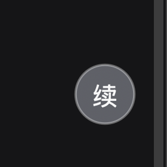

# WeChat Voice Guard · 微信语音输入防丢字


**在微信电脑版「语音输入」报「输入失败」、识别结果即将消失的那一刻，把文字截下来。**

macOS + [Hammerspoon](https://www.hammerspoon.org/)。适用于微信 4.1.8+ 的「按住 `fn` 说话」全局语音输入。

> Intercept the speech-to-text result that WeChat for Mac throws away when its voice input
> fails to insert (you weren't focused on a text field) — so you never lose the transcription.
> Implemented with a `CGEventTap` in Hammerspoon. macOS only.

> [!IMPORTANT]
> **动手前先看 [⚠️ 已知限制](#️-已知限制用之前先看)**。其中三条会日常影响使用：
> ①别的应用占用麦克风结束时会误触发一次续上；②全屏应用里悬浮球可能被盖住；
> ③重载配置后 `state.json` 的历史会清零（`capture.log` 不受影响，一条不丢）。

---

## 问题

微信电脑版 4.1.8+ 的「语音输入」是一个**全局听写**：按住 `fn` 说话，识别结果上屏到当前焦点输入框
（[官方说明](https://www.ithome.com/0/930/754.htm)）。但如果你说话时没把光标放在输入框里，
它会提示「**输入失败**」，那段识别结果就随浮窗一起消失了——而长时间静音时它会**自动停止**，
根本来不及点回输入框。

## ⚠️ 已知限制（用之前先看）

这些不是「理论上可能」，都是我在自己机器上实际撞到或主动留下的口子。

| # | 限制 | 你会遇到什么 | 怎么处理 |
|---|---|---|---|
| 1 | **别的应用占用麦克风结束时，也会被判成「空转写结束」**（空转写续上靠麦克风释放判定） | 开完会 / 录完音，会莫名其妙多按一次 `ctrl+fn` | 把 `CONFIG.autoResume.emptyEndResume` 设为 `false`——只保留「有文字」那条路径，它**绝不会误判** |
| 2 | **悬浮球用的是 `floating` 层级** | 全屏应用（全屏视频、全屏编辑器）里球可能被盖住 | 把 `ballCreate()` 里的层级改成 `status` 或 `screenSaver`（一行） |
| 3 | **`state.json` 的历史在重载配置时清零**（`deploy.sh` 会重载，所以每次改配置都会清） | `⌥⌘C`（复制上一条）只能翻到重载之后的记录 | 数据**没丢**：`capture.log` 是追加式的、一条不落；要持久化就补一个启动回读 |
| 4 | **开启自动续上会让麦克风长时间常开** | 隐私上就是「一直在听」 | 这正是该功能的用途；不用时**单击悬浮球**关掉（球变灰） |
| 5 | **只在微信 4.1.15 / macOS 15.0.1 上实测过** | 微信升级后事件形态可能变化，捕获会静默失效 | `events.log` 是唯一可靠的验证手段（有 `pid=… keycode=0` 行就说明机制没变） |
| 6 | **「长时间静音自动停止」本身没有可调设置** | 停就是会停 | 这是外部兜底工具，不是修改微信行为 |
| 7 | **拦截模式开启时文字不会上屏** | 识别结果只进剪贴板 | 只在明确不想让它打字进去时开（`⌥+单击球` / `⌥⌘I`） |
| 8 | **只支持 macOS** | —— | Windows 上机制不同（`Ctrl+Win` 触发），本仓库不适用 |

## 已实测确认的机制

微信并不是「先检查焦点、失败就放弃」，而是**先把整段识别结果合成一个键盘事件发出去，之后才报错**。

`events.log` 实证（文字已打码）：

```
19:26:12  pid=2985(微信) keycode=0 flags=[] unicode='<整段识别结果，实测 636 字>' focused=?|
19:28:58  pid=2985(微信) keycode=0 flags=[] unicode='<同一轮的短句，实测 7 字>'      focused=?|
```

- `keycode=0` + 整段文字作为 unicode 串 = `CGEventKeyboardSetUnicodeString` 的标准用法
- `focused=?` = 当时**没有**任何焦点输入框（正是「输入失败」的场景）
- **事件照样发出** ⇒ 外部可以在它被丢弃之前截获，一个字都不会丢

这推翻了先前的假设（原以为它会走「写剪贴板 + 模拟 ⌘V」，实测 `flags=[]`，没有任何 ⌘V）。
它也解释了为什么失败时剪贴板里有时能捞到内容：微信会**顺带**写一次剪贴板，并很快还原。

## 它给你什么

每次语音输入，**不论上屏成功还是失败**：

- 全文写入 `~/Library/Logs/WeChatVoiceGuard/capture.log`（追加流水，永不丢）
- 最近 300 条存入同目录 `state.json`
- **最新一条自动放进剪贴板** ⇒ 失败时直接 `⌘V` 就能补上
- 系统通知提示已截获

## 安装

```bash
brew install --cask hammerspoon --appdir="$HOME/Applications"
git clone https://github.com/frank3215/wechat-voice-guard.git
cd wechat-voice-guard
./deploy.sh
```

`deploy.sh` 会把 `init.lua` 复制到 `~/.hammerspoon/init.lua` 并重启 Hammerspoon。

然后：**系统设置 → 隐私与安全性 → 辅助功能 → 勾选 Hammerspoon**。

> 实测**不需要**「输入监控」权限——有辅助功能权限，`CGEventTap` 就能收到键盘事件。
> 验证方式见下面的自检（`键盘事件>0` 即为生效）。

> 改完 `init.lua` 建议先跑 `./tools/run_mock.sh`。它**只检查 Lua 语法与顶层加载**，
> 测不到任何真实行为（没有 macOS、没有微信、没有钩子）；它的唯一价值是别把语法坏掉的配置
> `deploy` 出去——那会让 Hammerspoon 静默变成什么都不做的空壳。
> 仓库里的 `lint` workflow 跑的就是它（Linux runner 上装 `lua5.4`），所以那个徽章只是语法自检，不是功能测试。

## 热键

| 热键 | 作用 |
|---|---|
| `⌥⌘C` | 复制上一条被捕获的文字 |
| `⌥⌘V` | 手动快照当前焦点输入框的文字 |
| `⌥⌘I` | 切换拦截模式：开 = 吞掉微信的注入事件（文字只进剪贴板，不上屏） |
| `⌃⌥⌘D` | dump 微信 AX 元素树（**手动诊断用**，会阻塞输入几秒，属正常） |
| `⌥⌘L` | 打开捕获日志 |

## 可选功能：转写停止后自动「续上」

微信长时间静音会自动停止听写。开启后，每次转写结束（捕获到一次微信注入事件）都会自动补按
一次快捷键（默认 `control+fn`），把听写重新接上，不用手再去够键盘。

| 热键 | 作用 |
|---|---|
| `⌥⌘S` | 开关自动续上（状态存盘，重载后保持） |
| `⌥⌘T` | 手动补按一次（**先用它确认键位/策略对不对**，无视开关与间隔） |

配置在 `init.lua` 顶部的 `CONFIG.autoResume`：

| 键 | 默认 | 说明 |
|---|---|---|
| `enabled` | `false` | 开关状态由 `autoresume.state` 记住 |
| `combo` | `{mods={"ctrl"}, key="fn"}` | 要补按的组合 |
| `strategy` | `"flags"` | fn 是**修饰键**，官方推荐发 `flagsChanged` 事件；微信若不响应可改 `"key"`（keyDown/keyUp）或 `"both"` |
| `mode` | `"tap"` | `tap` = 轻点一下；`hold` = 按住，直到下次转写结束才放 |
| `delay` | `0.8` | 转写结束后等多久再补按（秒） |
| `holdMs` | `80` | tap 模式的按下时长（毫秒） |
| `maxHoldSec` | `90` | hold 模式的安全释放超时，防止 `fn` 被永久按住 |
| `minGap` | `2.0` | 两次续上之间的最小间隔（秒） |
| `maxChain` | `100` | 连续续上的硬上限，达到就自动关闭（`0` = 不限） |

> **触发条件有两个**
> 1. **有文字的转写结束** —— 微信注入事件（实测可靠）
> 2. **空转写结束**（一个字都没识别出来时，微信**不发任何事件**）——
>    靠**麦克风占用释放**判定：语音输入期间默认输入设备一直被占用，释放即会话结束。
>    每 0.5s 读一次纯本地 CoreAudio 状态（不与其他进程 IPC），设备对象做了缓存，
>    首次解析的约 300ms 开销挪到启动阶段预热——避免它落在输入路径上
>
> **注意**
> - 这个功能的用途就是让微信语音输入长时间处于「一直在听」的状态——请自行权衡麦克风常开的隐私影响
> - `hold` 模式会让 `fn` 持续处于按下状态，可能改变功能键（F1–F12）的行为；
>   有 `maxHoldSec` 超时兜底，且每次重载配置都会先清一次可能残留的修饰键状态
> - 别的应用占用麦克风（会议、录音）结束时，也可能被判成「空转写结束」而多按一次；
>   不想要这条路径就把 `emptyEndResume` 设为 `false`
> - 微信是「轻点」还是「按住」触发，先用 `⌥⌘T` 手动试一次确认

## 桌面悬浮球



`⌥⌘B` 显隐。球本身（置顶，跨 Space 都在）：

| 操作 | 作用 |
|---|---|
| 左键单击 | 开关「自动续上」 |
| `⌥` + 左键单击 | 开关「拦截模式」 |
| 按住拖动 | 挪位置（球跟着鼠标走，松开即记住；位置存盘） |

颜色含义：

| 外观 | 含义 |
|---|---|
| 绿色 | 自动续上：开 |
| 灰色 | 自动续上：关 |
| 外圈橙色细环 | 拦截模式：开 |
| 闪一下青色 | 刚截获到一段语音文字 |

实现说明：用 `hs.canvas` **原生绘制**——不起额外进程、不做任何轮询，只在状态变化时重绘。
点击它**不会抢焦点**（`clickActivating(false)`），所以不会把你的输入框弄失焦。

> 踩坑：canvas 的**元素级** `trackMouseDown/Up` 和 **canvas 级** `canvasMouseEvents` 不能同时开，
> 否则同一次点击会被投递两遍，表现为「点一下翻转两次」。本仓库只走 canvas 级。
>
> 拖拽**不是**靠 canvas 的 `mouseMove` 事件（实测根本收不到，第一版因此拖不动），
> 而是按下时起一个 60Hz 循环自己读 `hs.mouse.absolutePosition()` 来移动窗口，
> 并用 `hs.eventtap.checkMouseButtons()` 兜底检测「按键已松开但 mouseUp 丢了」的情况。
> 每次拖拽都会在 `capture.log` 里留下 `[ball] mouseUp：moved=… 位移=…px 耗时=…s`，
> 拖不动时看这行就知道是事件没到还是判定错了。

## 实测验证记录（2026-10-12，本机 微信 4.1.15 / macOS 15.0.1）

| 验证项 | 日志证据 |
|---|---|
| 有文字的转写被截获 | `[eventtap] … 1597 字`——微信提示「输入失败」时，文字已入库并自动进剪贴板 |
| **空转写结束也能续上** | `[mic] 开始被占用` → `[mic] 释放（会话 4.0s，本次无文本）` → `[resume] 轻点 ctrl+fn` → **1 秒后 `[mic] 开始被占用`**（微信听写确实被重新唤起，闭环成立） |
| 关掉开关后不再续上 | 关闭后下一次 `[mic] 释放` 之后没有任何 `[resume]` 行 |
| 悬浮球拖拽 + 位置存盘 | `[ball] 按键已松开（mouseUp 未送达）：moved=true 位移=97px`，`ball.state` 同步更新，重载后仍在原位 |
| 单击只触发一次翻转 | `[ball] mouseUp：moved=false … → 判为点击` 只出现一次 |
| 不给系统添延迟 | 心跳 `钩子被禁用=0`；`[perf]` 只出现在**启动预热**阶段（音频设备首次解析 139–465ms，已缓存并移到启动） |

这些结论都是在真微信 + 真实键盘输入上跑出来的，不是"理论上可行"。

## 钉到 Dock / Launchpad 的一键启动图标

```bash
./tools/build_app.sh --pin-dock
```

- 构建一个真正的 `.app`（`~/Applications/WeChat Voice Guard.app`）：**双击 = 启动 Hammerspoon**（若能读到仓库，顺带同步最新配置）
- 配置与已部署的一致时，双击只是「确保在运行」；有变化才重启（避免每次双击都清掉内存里的历史）
- 图标由 `tools/make_icon.swift` 用 Swift **现画**（绿色渐变圆角 + 白「续」，与悬浮球同一套视觉），
  可从源码一键重建，仓库不依赖任何设计素材
- `--pin-dock` 会写 `com.apple.dock persistent-apps` 并重启 Dock；不加参数则只构建
- 卸载：把图标从 Dock 拖走，再 `rm -rf "~/Applications/WeChat Voice Guard.app"`

> **两个必须知道的坑**
> 1. `.app` 建好后必须 `lsregister -f` **注册到 LaunchServices**。未注册时 `open` 会**返回 0 却什么都不做**
>    ——脚本不跑、日志里毫无痕迹，是最难查的那种"假成功"。`build_app.sh` 已自动注册。
> 2. shell 脚本里**变量后紧跟中文标点**要写成 `${NAME}`，否则 bash 会把标点当作变量名的一部分，
>    在 `set -u` 下直接 `unbound variable` 报错。

## 命令行：`wxguard`

```bash
./tools/wxguard.sh install     # 软链到 ~/.local/bin/wxguard（该目录已在你 ~/.zshrc 的 PATH 里）
```

| 命令 | 作用 |
|---|---|
| `wxguard` / `wxguard status` | 进程 / 自动续上 / 悬浮球 / 最近日志一览 |
| `wxguard start` | 部署最新配置（有变化才重启）并启动 |
| `wxguard stop` | 停止（捕获、自动续上、悬浮球一起停） |
| `wxguard restart` | 无条件重载配置并重启 |
| `wxguard log [-f]` | 看日志 / 持续跟踪 |
| `wxguard rescue` | 列出抢救箱（救回的语音正文） |
| `wxguard install` / `uninstall` | 装 / 卸 PATH 软链 |

Dock 应用只是 `wxguard start` 的一层外壳，两边逻辑同源（构建时把脚本拷进 .app 包内）。

> **为什么脚本必须拷进 .app 包内**
> macOS 不允许 GUI 启动的应用执行 `~/Downloads` 里的文件，报
> `Operation not permitted`、退出码 **126**（实测）。所以 .app 自带一份 `Resources/wxguard.sh`，
> 仓库路径通过环境变量 `WXG_REPO` 传入，**只用于"读最新配置"这类可选动作，读不到就跳过**。
>
> 后果：改了 `init.lua` 后要么重跑 `./tools/build_app.sh`，要么在终端 `wxguard restart`
> （终端有 Downloads 权限，能直接读仓库）。
>
> 同理，**.app 的操作步骤必须幂等**：`cp`/`cmp` 都做了失败即跳过的处理，否则 GUI 环境下会直接报错退出。

## 自检

```bash
grep -E "\[hb\]|\[tap\]|\[pb\]" ~/Library/Logs/WeChatVoiceGuard/capture.log
```

| 输出 | 含义 |
|---|---|
| `[tap] 事件钩子启动 isEnabled=true` | 事件钩子已创建 |
| `[hb] 近60秒键盘事件=N`（N>0） | 钩子确实在收键盘事件（权限 OK） |
| `[hb] … 微信来源=N` | 微信注入过 N 次 |
| `[hb] … 钩子被禁用=0` | **必须一直是 0**。在涨 = 回调变慢被系统禁用了，用户会感到输入卡顿 |
| `[perf] … 耗时 XXXms` | 某一步超过 50ms。**出现就说明回调路径被拖慢了**，必须查 |

## 设计要点 · 踩过的坑（改代码前务必读）

### ① 绝对不要在事件回调里做重活（这是最贵的一课）

`CGEventTap` 是**过滤型**的：macOS 必须等回调返回，才把按键交给前台应用。而 Hammerspoon 的 Lua
全部跑在主线程上，所以**回调路径上任何耗时操作都直接变成用户键盘上的延迟**。

v1 就是这么翻车的：我在回调路径上顺手加了自动 AX 树扫描、每 5 秒一次的 `runningApplications()`
全应用枚举、以及文件写入。结果是系统反复因为 `kCGEventTapDisabledByTimeout`（系统日志里表现为
`BREADCRUMB: eventtap restarted: (-2)`）把钩子禁用——用户感受到的就是「用输入法打字一卡一卡、
有时按键被吞」。

现在的铁律：

- 事件回调只做**纯 Lua 表查找 + 取字段**（微秒级）：先查 `wxPidSet[pid]`，不是微信就立刻返回
- **绝不**在回调里碰 AX、剪贴板、文件 I/O、`runningApplications()`
- 微信进程表由 10 秒一次的定时器维护，回调只查表
- 重活一律 `hs.timer.doAfter(0, ...)` 延后到回调之外
- 所有可能变慢的步骤套 `withPerf` 计时，超过 50ms 就写 `[perf]` 日志

### ② 自动 AX 扫描已整层删除

微信 4.1.15 是自绘原生 UI，AX 树里 `AXText*` 元素数量为 **0**，语音浮窗只是个 420×40 的
`AXWindow/AXSystemDialog`，读不到任何文本。所以自动 AX 扫描**既没用又有害**（见 ①），已删除；
只保留 `⌃⌥⌘D` 手动 dump 用于诊断。

### ③ Hammerspoon 的定时器必须挂在全局强引用上

`hs.timer.doEvery` 的定时器即使存进局部变量也没用——`init.lua` 这个 chunk 执行完后局部变量
即不可达，定时器会被 Lua GC 回收并**静默停摆**。现象是启动几秒后日志再无任何输出。
本仓库的做法是挂到 `_G.WXGUARD`。

### ④ 捕获路径上任何字段取值都要容错

曾经因为取焦点元素失败（返回 nil）时执行了 `ftitle:sub()` 抛错，导致整行诊断日志
**连带后面的保存动作一起被吞掉**——一次 636 字的语音就这样丢了，而日志里连错误都没有。
现在：捕获动作排在诊断日志之前，且全程 `pcall`。

### ⑤ 短文本的「静默丢字」比崩溃更阴

流式前缀合并 / 去重如果只按字符串关系判断，会吃掉两种情况：
①隔了很久后重复说同一句话被去重；②短句恰好是上一条的前缀，被并进上一条且因更短而不留痕迹。
本仓库用 `mergeWindow`（默认 5 秒）把合并/去重限制在同一会话内。

### ⑥ 配置和日志不要放 `~/Downloads`（macOS 15 的 TCC 受保护目录），Hammerspoon 写入会被**静默拒绝**。
   本仓库把日志放在 `~/Library/Logs/`。
5. **微信上屏失败后会快速还原剪贴板**，所以剪贴板兜底必须够快：
   `changeCount` 轮询 0.1s ＋ 微信事件瞬间同步抢读 ＋ 事件后 0.05/0.12/0.3/0.6/1.2s 追读。

## 为什么不用其它方案（都有实测依据）

| 方案 | 结论 |
|---|---|
| **辅助功能 AX 读浮窗文字** | ❌ 微信 4.1.15 是自绘原生 UI，整棵 AX 树里 `AXText*` 元素数量 = **0**；语音浮窗只是一个 420×40 的 `AXWindow/AXSystemDialog`，读不到任何文本 |
| **读进程内存** | ❌ SIP 已启用 + 微信是 hardened runtime + 沙盒签名且**无 `get-task-allow`**，`lldb` 附加被系统拒绝（`Not allowed to attach to process`）。要绕过就得关 SIP 或用 `get-task-allow` 重签名，后者会改变 sandbox 的 application-identifier、丢掉微信的容器数据与登录态 |
| **MITM 截 ASR 流量** | ❌ 腾讯自有加密协议（MMTLS/自定义），且走 Chromium network service（`--utility-sub-type=network.mojom.NetworkService`），证书固定 |
| **剪贴板历史工具**（Clipy / Raycast） | ⚠️ 只在微信顺带写剪贴板时有效，且它很快还原，普通 1 秒级轮询会漏 |
| **`CGEventTap` 截合成事件** | ✅ **本方案**。实测微信在失败路径上照样把整段文字作为 unicode 事件发出 |

## 局限

见文首的 [⚠️ 已知限制](#️-已知限制用之前先看)——那份清单是唯一权威版本，别处不再重复维护。

## 文件

| 文件 | 说明 |
|---|---|
| `init.lua` | Hammerspoon 配置（唯一源码） |
| `deploy.sh` | 部署 + 重启 Hammerspoon + 打印状态 |
| `tools/mock_test.lua` | 用假 `hs` API 加载配置，抓语法错误与顶层运行时错误 |
| `tools/run_mock.sh` | 上面那个的包装（解析 lua 路径、把 `HOME` 指向临时目录，避免污染真实日志） |

运行时产物（不在仓库内）：

| 路径 | 说明 |
|---|---|
| `~/Library/Logs/WeChatVoiceGuard/capture.log` | 捕获流水 |
| `~/Library/Logs/WeChatVoiceGuard/events.log` | 微信注入的原始事件（keycode/flags/unicode/焦点） |
| `~/Library/Logs/WeChatVoiceGuard/state.json` | 最近 300 条历史 |
| `~/Library/Logs/WeChatVoiceGuard/ax-tree.txt` | AX 树快照（诊断） |

## License

MIT
